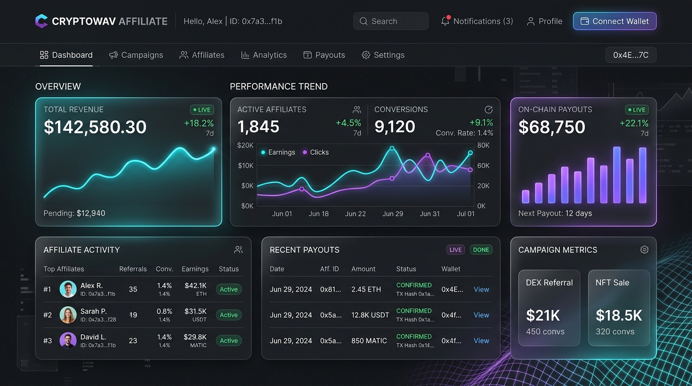

# Jibril Raji Qasim — Portfolio

A modern, high-performance developer portfolio built with **Next.js 15 (App Router)**, **Tailwind CSS v4**, **TypeScript**, and **Framer Motion**, tailored for a **Senior Web3 & Backend Engineer**.



## ⚡ Tech Stack

- **Framework:** [Next.js 15](https://nextjs.org/) (App Router, Turbopack)
- **Styling:** [Tailwind CSS v4](https://tailwindcss.com/) with Cyber Dark Web3 theme & glassmorphism
- **Language:** [TypeScript](https://www.typescriptlang.org/) (Strict type checking)
- **Animations:** [Framer Motion](https://www.framer.com/motion/)
- **Icons:** [Lucide React](https://lucide.dev/) & Custom SVG brand components
- **Backend & Web3 Integration:** Next.js Server Actions, RESTful APIs, EVM & BlockDAG ecosystem contracts

---

## 🌟 Key Features

- **Cyber Web3 Aesthetics:** Ambient glowing orbs, glassmorphic panels, neon status badges, and smooth dark-mode palette.
- **Interactive Terminal / CLI:** Embedded interactive developer console with runnable commands (`whoami`, `bio`, `skills`, `projects`, `chains`, `contact`, `clear`) and quick shortcuts.
- **Interactive Project Showcase:** Filter projects by category (Web3, Backend), view tech stacks, and click to inspect full architecture details in the interactive modal dialog.
- **Dynamic Skill Filtering:** Filter engineering proficiencies across Backend & Systems, Web3 & Blockchain, and Frontend & UI.
- **Working Contact Form:** Server-action-powered contact submission with client-side validation, direct email copying, and real-time dispatch feedback.
- **Career & Hackathon Timeline:** Chronicles hackathons (BlockDAG, Stacks), backend production systems (StormSale, Fixeroni), and academic foundations.
- **Fully Responsive & Accessible:** Optimized for seamless display across mobile, tablet, and widescreen desktop displays.

---

## 🚀 Getting Started

### Prerequisites

- Node.js `v18.18+` or `v22+` (LTS recommended)
- npm, pnpm, yarn, or bun

### Installation

1. Clone or navigate to the repository directory:
   ```bash
   cd my-portfolio
   ```

2. Install dependencies:
   ```bash
   npm install
   ```

3. Run the development server:
   ```bash
   npm run dev
   ```

4. Open [http://localhost:3000](http://localhost:3000) in your browser.

---

## 🏗️ Production Build

To build the optimized static production bundle:

```bash
npm run build
```

To preview the production build locally:

```bash
npm run start
```

---

## 📂 Project Structure

```text
my-portfolio/
├── public/
│   ├── favicon.ico
│   └── images/
│       ├── hero.png           # Workstation profile photo
│       ├── hero1.png          # Xpend logo asset
│       └── projects/          # High-resolution project visuals
├── src/
│   ├── app/
│   │   ├── actions/
│   │   │   └── contact.ts     # Server action for contact submission
│   │   ├── globals.css        # Tailwind v4 theme, glassmorphism & gradients
│   │   ├── layout.tsx         # Root layout with SEO metadata & ambient lighting
│   │   └── page.tsx           # Home page assembling all sections
│   ├── components/
│   │   ├── About.tsx          # Bio & dynamic skill category tabs
│   │   ├── Contact.tsx        # Working contact form & direct coordinates
│   │   ├── ExperienceTimeline.tsx # Career & hackathon trajectory
│   │   ├── Footer.tsx         # Telemetry specs, navigation, & back-to-top
│   │   ├── Hero.tsx           # Hero intro, availability badge & profile card
│   │   ├── InteractiveTerminal.tsx # Embedded developer CLI emulator
│   │   ├── Navbar.tsx         # Glassmorphic header & mobile drawer
│   │   ├── ProjectModal.tsx   # Detailed project architecture modal
│   │   ├── Projects.tsx       # Filterable project showcase grid
│   │   ├── Services.tsx       # Core engineering capabilities
│   │   ├── SocialIcons.tsx    # Crisp SVGs for GitHub, LinkedIn, Twitter/X
│   │   └── StatsBar.tsx       # Key metrics highlights
│   └── lib/
│       └── utils.ts           # Classnames utility (clsx + twMerge)
├── package.json
└── tsconfig.json
```

---

## 📜 License

© 2025 Jibril Raji Qasim. All rights reserved.
